<!-- Official GLFS project README. Image paths are relative to the repository root. -->
<div align="center">

# ✨ Gaussian Light Field Splatting (GLFS)

### A Physical Prior-Driven Vision Transformer for Low-Light Image Enhancement

**IEEE Transactions on Circuits and Systems for Video Technology (IEEE TCSVT), 2026 · Early Access**

[Yuhan Chen](https://github.com/YuhanChen2024) · Wenxuan Yu · Guofa Li · Fuchen Li · Kunyang Huang · Yicui Shi · Ying Fang · Wenbo Chu · Keqiang Li

[](https://ieeexplore.ieee.org/document/11797596)
[](https://arxiv.org/abs/2606.17985)
[](https://pytorch.org/)
[](LICENSE)

[](https://github.com/YuhanChen2024/Gaussian-Light-Field-Splatting/stargazers)
[](https://github.com/YuhanChen2024/Gaussian-Light-Field-Splatting/forks)
[](https://github.com/YuhanChen2024/Gaussian-Light-Field-Splatting/issues)

**[📄 Published Paper](https://ieeexplore.ieee.org/document/11797596) · [📑 Preprint](https://arxiv.org/abs/2606.17985) · [🚀 Quick Start](#-quick-start) · [📦 Model Zoo](#-model-zoo--evaluation-data) · [🖼️ Gallery](#-visual-results)**

---

### Bring light back to the dark — with physics-guided attention.

*Model the light. Preserve the color. Recover the details.*

<a href="Fig/11.png">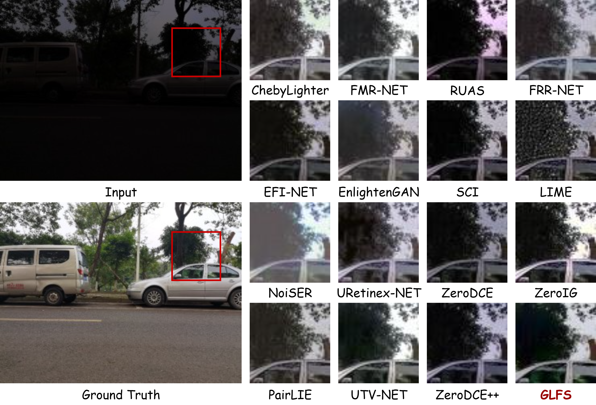</a>

<sub>Zoomed-in comparison on LSRW-Huawei (Fig. 14 in the paper). Click the image to explore the details.</sub>

<br>

<table>
<tr>
<td align="center" width="25%"><strong>6 / 6</strong><br><sub>Highest PSNR under our paper's evaluation protocol</sub></td>
<td align="center" width="25%"><strong>27.25 dB</strong><br><sub>PSNR on LOL-v2-Real</sub></td>
<td align="center" width="25%"><strong>7.804 M</strong><br><sub>Model parameters</sub></td>
<td align="center" width="25%"><strong>6 benchmarks</strong><br><sub>Pretrained weights &amp; evaluation sets</sub></td>
</tr>
</table>

**If GLFS helps your research or projects, please consider giving this repository a ⭐!**

</div>

---

## 📢 News

- **[2026]** GLFS has been accepted by **IEEE TCSVT** and is available in [IEEE Xplore Early Access](https://ieeexplore.ieee.org/document/11797596).
- **[2026-11-05]** The [arXiv preprint](https://arxiv.org/abs/2606.17985v2) has been updated to version 2.
- **[2026-06-16]** The [first arXiv preprint](https://arxiv.org/abs/2606.17985v1) was released.

### Open-source release

- [x] PyTorch implementation of GLFS, including training and evaluation.
- [x] Pretrained checkpoints for all six benchmark settings.
- [x] Paired evaluation images for all six benchmark settings.
- [x] Original-resolution inference and evaluation.
- [x] Custom RGB image enhancement without ground-truth images.
- [x] Memory-aware tiled inference with automatic out-of-memory fallback.

> Start with the pretrained model — no retraining or manual dataset preparation is required to evaluate the included benchmark images once the repository assets are downloaded.

## 📖 Overview

Low-light enhancement is more than making an image brighter. Under complex, non-uniform illumination, existing approaches may introduce local overexposure, hue shifts, amplified noise, and loss of fine structures. Conventional Vision Transformers can capture long-range dependencies, but their attention is typically not explicitly constrained by illumination physics.

**GLFS** brings the continuous representation of **2D Gaussian Splatting (2DGS)** into a Vision Transformer as a physics-informed attention prior. Anisotropic Gaussian primitives describe the spatial distribution of light, providing a physically motivated representation for estimating spatially varying illumination gain.

The model combines Gaussian geometry, non-local semantic interactions, and hybrid supervision to restore images with natural exposure, faithful color, and preserved structural details.

| What makes GLFS different? | How GLFS addresses it |
| :--- | :--- |
| ☀️ **Continuous light-field modeling** | Anisotropic 2D Gaussian primitives characterize spatially varying illumination. |
| 🧠 **Physics-informed self-attention** | Gaussian affinity explicitly biases Transformer attention, connecting physical geometry with semantic features. |
| 🌈 **Color fidelity** | A color vector angular loss encourages hue consistency while allowing brightness to change. |
| 🔍 **Structural preservation** | A luminance-domain Sobel edge loss helps preserve fine details. |
| ⚡ **Practical inference** | The released RGB model supports original-resolution enhancement and optional overlap-tiled inference. |

## 🏗️ Method

### Overall architecture

<div align="center">
<a href="Fig/1.png">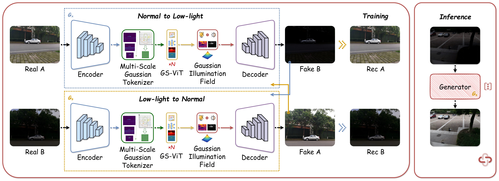</a>
<br>
<sub><b>Fig. 1.</b> Overall training and inference framework of GLFS. An encoder–decoder architecture incorporates a physics-prior-driven GS-ViT bottleneck, with bidirectional adversarial and hybrid supervision during training.</sub>
</div>

The architecture is built around three physical-prior modules:

| Module | Core idea |
| :--- | :--- |
| **MGT** · Multi-Scale Gaussian Tokenizer | Extract Gaussian geometry and semantic features from coarse- and fine-scale encoder representations. |
| **GS-ViT** · Gaussian Splatting Vision Transformer | Incorporate anisotropic Gaussian affinity into self-attention and progressively refine Gaussian parameters. |
| **GIF** · Gaussian Illumination Field | Infer a spatial gain field conditioned on illumination, noise response, and Gaussian opacity to guide decoding. |

<details open>
<summary><b>① Multi-Scale Gaussian Tokenizer (MGT)</b> — from discrete features to continuous Gaussian primitives</summary>

<br>

<div align="center">
<a href="Fig/2.png">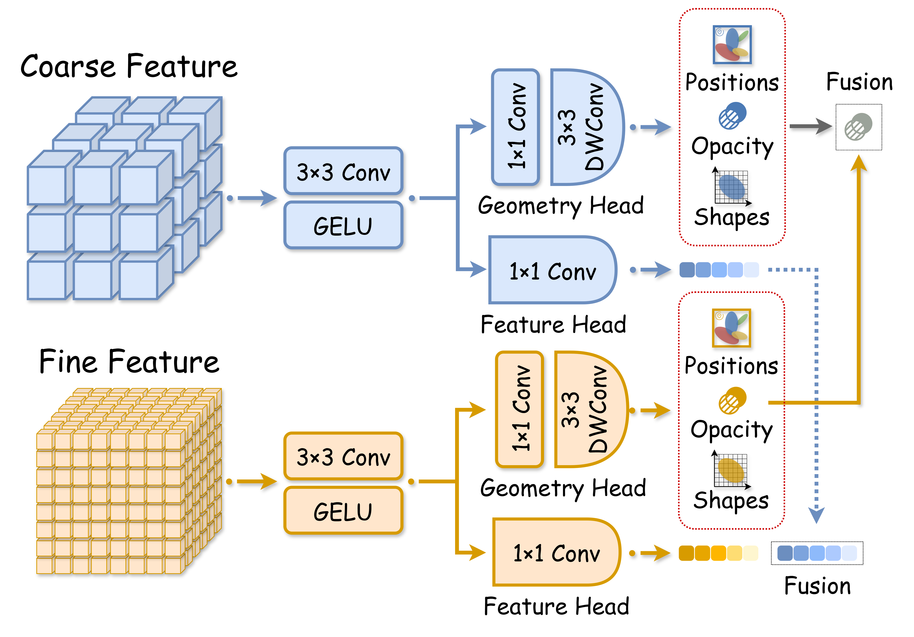</a>
<br>
<sub><b>Paper Fig. 3.</b> Detailed architecture of the proposed MGT.</sub>
</div>

The coarse branch captures the global light distribution, while the fine branch complements local high-frequency information. Separate geometric and feature heads estimate Gaussian centers, inverse covariances, opacities, and semantic embeddings.

</details>

<details open>
<summary><b>② GS-ViT</b> — physics-informed Gaussian Splatting Attention</summary>

<br>

<div align="center">
<a href="Fig/3.png">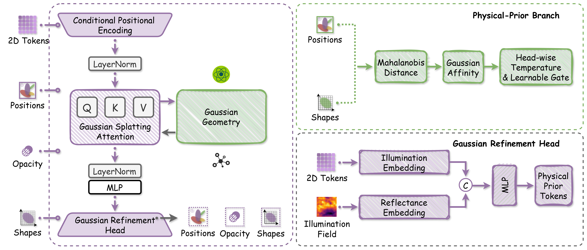</a>
<br>
<sub><b>Paper Fig. 5.</b> Detailed architecture of the proposed GS-ViT module.</sub>
</div>

Gaussian Splatting Attention (GSA) injects a learnable, anisotropic Gaussian affinity bias into the attention logits. Gated refinement updates Gaussian parameters while maintaining valid covariance geometry.

</details>

<details open>
<summary><b>③ Gaussian Illumination Field (GIF)</b> — illumination-aware gain estimation</summary>

<br>

<div align="center">
<a href="Fig/4.png">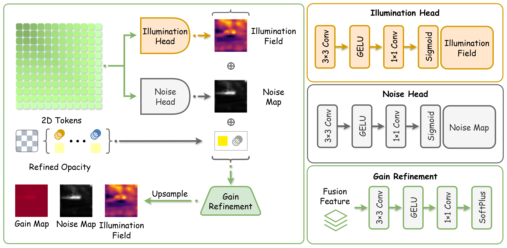</a>
<br>
<sub><b>Paper Fig. 7.</b> Detailed network configuration of the proposed GIF.</sub>
</div>

The illumination and noise-response heads, together with refined Gaussian opacity, guide the estimation of a smooth spatial gain field. Instead of directly multiplying the low-light input by this gain map, GLFS injects the gain into decoder features and uses a gated global residual connection to reconstruct the enhanced image.

</details>

### Physical intuition

A continuous illumination field can be represented as a superposition of anisotropic Gaussian basis functions:

$$
\mathcal{L}(\mathbf{x}) =
\sum_{k=1}^{K}\alpha_k
\exp\left[-\frac{1}{2}
(\mathbf{x}-\boldsymbol{\mu}_k)^\top
\boldsymbol{\Sigma}_k^{-1}
(\mathbf{x}-\boldsymbol{\mu}_k)\right].
$$

Here, $\boldsymbol{\mu}_k$, $\boldsymbol{\Sigma}_k$, and $\alpha_k$ describe the center, covariance, and opacity of each Gaussian primitive. Gaussian affinity derived from this geometry introduces an explicit physical bias into Transformer self-attention, bridging continuous illumination modeling and discrete feature learning.

The training objective combines adversarial and cycle-consistency constraints, paired reconstruction supervision, and reference-free physical regularization. See [the paper](https://ieeexplore.ieee.org/document/11797596) for the full formulation.

## 🏆 Quantitative results

GLFS is evaluated against 20 representative low-light image enhancement methods across six benchmark settings. **Under the unified training and evaluation protocol in the paper, GLFS achieves the highest PSNR on all six benchmarks**, while remaining competitive in structural and perceptual quality.

| Benchmark | PSNR ↑ (dB) | SSIM ↑ | LPIPS ↓ | NIQE ↓ | LOE ↓ | DE ↑ | EME ↑ |
| :--- | ---: | ---: | ---: | ---: | ---: | ---: | ---: |
| LOL-v1 | **24.38** | 0.84 | 0.12 | 4.14 | 27.16 | 2.44 | 7.59 |
| LOL-v2-Real | **27.25** | 0.87 | 0.10 | 4.11 | 32.57 | 2.38 | 6.30 |
| LOL-v2-Synthetic | **26.46** | 0.93 | 0.17 | 4.40 | 20.75 | 1.22 | 11.25 |
| LSRW-Huawei | **21.47** | 0.61 | 0.21 | 3.02 | 9.40 | 2.48 | 11.07 |
| LSRW-Nikon | **17.82** | 0.54 | 0.23 | 3.11 | 10.50 | 1.28 | 9.80 |
| SID | **22.46** | 0.56 | 0.41 | 4.20 | 16.79 | 2.03 | 17.30 |

<sub>Values are reported from Tables I–VI of the accepted paper, not newly measured by this README. Bold denotes the highest PSNR among the compared methods under the paper's protocol; GLFS does not lead every metric. See the paper for all baselines and the evaluation setup.</sub>

| Parameters | FLOPs | Reported inference latency |
| :---: | :---: | :---: |
| 7.804 M | 66.824 G | 14.471 ms |

<sub>Complexity and latency are as reported in the paper; latency depends on image size, hardware, precision, and measurement protocol.</sub>

## 🚀 Quick Start

### 1. Clone the repository

```bash
git clone https://github.com/YuhanChen2024/Gaussian-Light-Field-Splatting.git
cd Gaussian-Light-Field-Splatting
```

If model or dataset files are stored with Git LFS, install [Git LFS](https://git-lfs.com/) and run `git lfs pull` from the repository root.

### 2. Create the environment

The paper reports **PyTorch 2.4.0** and **CUDA 12.4**. The following is a suggested environment for the released implementation, using Python 3.10 and matching PyTorch/torchvision versions.

```bash
conda create -n glfs python=3.10 -y
conda activate glfs

# NVIDIA GPU / CUDA 12.4
pip install torch==2.4.0 torchvision==0.19.0 --index-url https://download.pytorch.org/whl/cu124

pip install "numpy<2" pillow

# Optional: LPIPS evaluation
pip install lpips
```

For other CUDA versions or CPU-only systems, install the appropriate PyTorch build from the [official PyTorch installation guide](https://pytorch.org/get-started/previous-versions/).

The core model is implemented using PyTorch operations; the released implementation does not import a custom Gaussian rasterization CUDA extension.

### 3. Enhance and evaluate LOL-v1

The pretrained enhancement generator is `best_net_G_B.pth`. Use `BtoA` to map low-light images to normal-light images.

```bash
python evaluate.py \
  --name LOLv1 \
  --eval_dir ./eval/LOLv1 \
  --checkpoints_dir ./checkpoints \
  --epoch best \
  --direction BtoA \
  --gpu_id 0 \
  --output ./eval_out/LOLv1
```

By default, `evaluate.py` processes RGB images at their original resolution (`--max_side 0`). If a full-resolution forward pass runs out of memory, it automatically retries with overlapping tiles.

Evaluation outputs:

```text
eval_out/LOLv1/
├── enhanced/              # Enhanced PNG images (input subfolders preserved)
├── per_image_metrics.csv  # Per-image metrics, runtime and inference mode
└── summary.json           # Aggregate metrics and inference statistics
```

> **Tip:** For strictly full-image inference without automatic tiling, add `--no_auto_tile`. Original-resolution output and full-image inference are not the same: tiled output preserves image size but can change the global illumination estimate.

## 📦 Model zoo & evaluation data

The release includes pretrained models and paired evaluation images for **all six benchmark settings**. Each checkpoint directory contains the `best` and `latest` versions of both generators and both discriminators — eight `.pth` files per setting (**48 checkpoint files and 499 paired evaluation images in total**).

**For enhancement alone, you only need the corresponding `best_net_G_B.pth` and model code.**

| Dataset | Evaluation pairs | Enhancement weights | All checkpoints | Evaluation images |
| :--- | ---: | :---: | :---: | :---: |
| LOL-v1 | 15 | [G_B](checkpoints/LOLv1/best_net_G_B.pth) | [Folder](checkpoints/LOLv1/) | [Data](eval/LOLv1/) |
| LOL-v2-Real | 100 | [G_B](checkpoints/LOLv2_Real/best_net_G_B.pth) | [Folder](checkpoints/LOLv2_Real/) | [Data](eval/LOLv2_Real/) |
| LOL-v2-Synthetic | 100 | [G_B](checkpoints/LOLv2_Syn/best_net_G_B.pth) | [Folder](checkpoints/LOLv2_Syn/) | [Data](eval/LOLv2_Syn/) |
| LSRW-Huawei | 30 | [G_B](checkpoints/LSRW_Huawei/best_net_G_B.pth) | [Folder](checkpoints/LSRW_Huawei/) | [Data](eval/LSRW_Huawei/) |
| LSRW-Nikon | 20 | [G_B](checkpoints/LSRW_Nikon/best_net_G_B.pth) | [Folder](checkpoints/LSRW_Nikon/) | [Data](eval/LSRW_Nikon/) |
| SID | 234 | [G_B](checkpoints/SID/best_net_G_B.pth) | [Folder](checkpoints/SID/) | [Data](eval/SID/) |

<sub>Evaluation counts refer to the included files. The SID release contains RGB image pairs; this implementation expects RGB input, not raw Bayer sensor files.</sub>

<details>
<summary><b>Checkpoint naming convention</b></summary>

| Filename pattern | Purpose |
| :--- | :--- |
| `best_net_G_B.pth` | Best saved enhancement generator: low-light → normal-light. |
| `best_net_G_A.pth` | Best saved reverse generator: normal-light → low-light. |
| `best_net_D_A.pth`, `best_net_D_B.pth` | Best saved discriminators for the two image domains. |
| `latest_net_G_B.pth`, `latest_net_G_A.pth` | Most recently saved generator weights. |
| `latest_net_D_A.pth`, `latest_net_D_B.pth` | Most recently saved discriminator weights. |

Use `--epoch latest` to load the most recently saved generator instead.

</details>

### Run all six benchmarks

On Bash (Linux, macOS with an appropriate backend, or WSL), run:

```bash
for dataset in LOLv1 LOLv2_Real LOLv2_Syn LSRW_Huawei LSRW_Nikon SID; do
  python evaluate.py \
    --name "$dataset" \
    --eval_dir "./eval/$dataset" \
    --epoch best \
    --direction BtoA \
    --gpu_id 0 \
    --output "./eval_out/$dataset" || exit 1
done
```

The evaluation script recursively discovers images inside `low/` and `high/`, so the included nested `low/low/` and `high/high/` folders do not need to be flattened. Reference images are matched by filename stem.

### Evaluation metrics and reproducibility

The paper evaluates PSNR, SSIM, LPIPS, NIQE, LOE, DE, and EME at original image resolutions. The released `evaluate.py` computes raw RGB PSNR and SSIM, luminance-channel PSNR and SSIM, MAE, and optional LPIPS. It also reports brightness-aligned PSNR and SSIM as separate diagnostic metrics.

> [!IMPORTANT]
> For fair comparisons, distinguish raw `psnr` / `ssim` from `psnr_align` / `ssim_align`, which use ground-truth mean brightness. The optional `--lpips` implementation uses an AlexNet backbone, whereas the paper reports VGG-based LPIPS. NIQE, LOE, DE, and EME are not implemented in this evaluation script. Do not expect exact reproduction of every paper metric from the default command alone.

For a closer match to the paper's evaluation setting, use FP32 inference (omit `--amp`), `--max_side 0`, and `--no_auto_tile`, and disable TF32 explicitly. For example:

```bash
python -c "import torch; torch.backends.cuda.matmul.allow_tf32=False; torch.backends.cudnn.allow_tf32=False; import evaluate; evaluate.main()" \
  --name LOLv1 --eval_dir ./eval/LOLv1 \
  --epoch best --direction BtoA --gpu_id 0 \
  --max_side 0 --no_auto_tile --output ./eval_out/LOLv1_fp32
```

The reported metrics can also depend on dataset preprocessing, metric implementation, and checkpoint configuration. The provided checkpoints should be used with matching generator architecture settings.

## 🎨 Enhance your own images

No paired reference images are required for inference. Place RGB low-light images into a directory such as `my_images/`.

```bash
python evaluate.py \
  --name LOLv2_Real \
  --low_dir ./my_images \
  --eval_dir "" \
  --epoch best \
  --direction BtoA \
  --gpu_id 0 \
  --output ./results/my_images
```

Your enhanced images will be saved under `results/my_images/enhanced/`. Choose a checkpoint suited to your input domain; `LOLv2_Real` is a starting point for real-world RGB photos, not a guarantee of the best result on every image.

<details>
<summary><b>Memory-saving options, CPU inference and useful arguments</b></summary>

| Argument | Description |
| :--- | :--- |
| `--gpu_id -1` | Run inference on the CPU (may be substantially slower). |
| `--amp` | Enable CUDA autocast inference to reduce memory usage; numerical results may vary. |
| `--force_tile` | Force overlapping tiled inference. |
| `--tile 512 --tile_overlap 96` | Set the tile size and overlap used during tiled inference. |
| `--no_auto_tile` | Disable automatic tiled fallback after an out-of-memory error. |
| `--max_side 1024` | Downscale inputs whose longest edge exceeds 1024 pixels. Omit to keep original resolution. |
| `--metric_on_cpu` | Compute reference-based metrics on CPU to save GPU memory. |
| `--lpips` | Compute optional AlexNet-based LPIPS when references are available. |
| `--epoch latest` | Load the latest saved generator. |
| `--direction AtoB` | Use the reverse (darkening) generator instead of enhancement. |

Example for a GPU with limited memory:

```bash
python evaluate.py --name LOLv2_Real \
  --low_dir ./my_images --eval_dir "" \
  --amp --force_tile --tile 512 --tile_overlap 96 \
  --gpu_id 0 --output ./results/tiled
```

Tiling uses Hann-window blending to merge overlapping patches. Because GLFS models global illumination, tiled inference may differ from full-image inference. Use smaller tiles if needed, and prefer full-image inference when memory allows.

</details>

## 🖼️ Visual results

From everyday scenes with non-uniform illumination to challenging extreme low-light conditions, explore GLFS across all six benchmarks. Click any figure to view it at full size.

<div align="center">

### LOL-v1

<a href="Fig/5.png">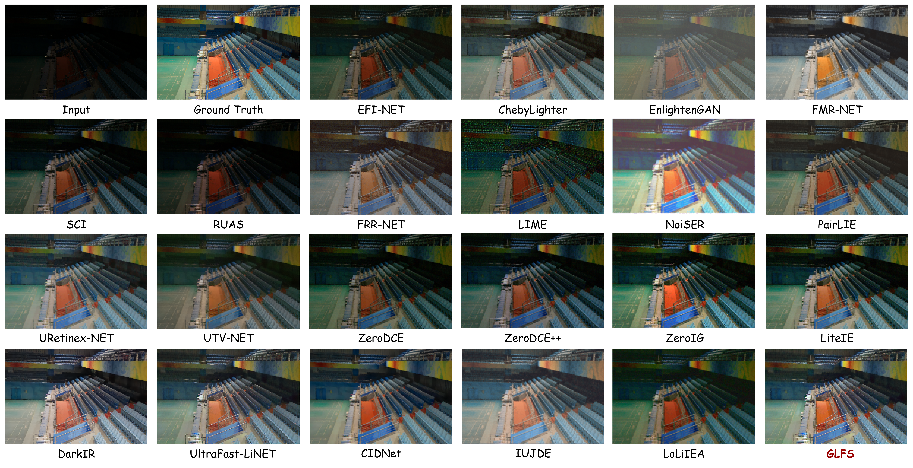</a>

<sub>Paper Fig. 8 · Real-world low-light image enhancement.</sub>

### LOL-v2-Real

<a href="Fig/6.png">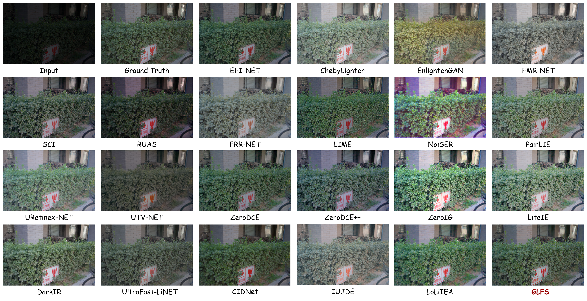</a>

<sub>Paper Fig. 9 · Real illumination degradation.</sub>

### LOL-v2-Synthetic

<a href="Fig/7.png">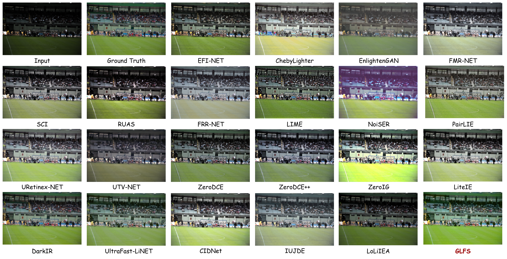</a>

<sub>Paper Fig. 10 · Synthetic illumination variations.</sub>

### LSRW-Huawei

<a href="Fig/8.png">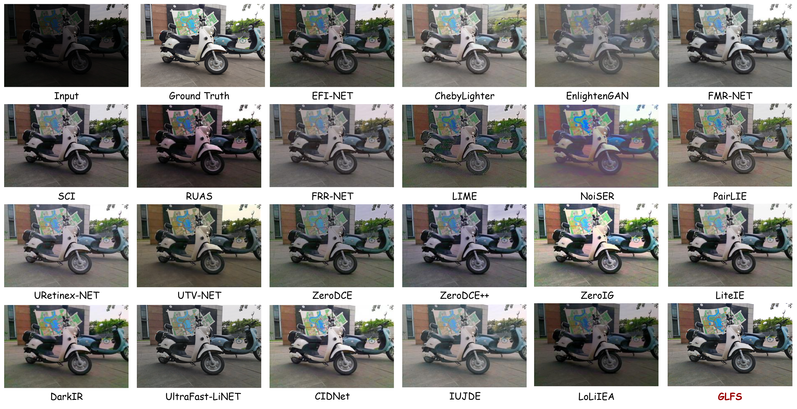</a>

<sub>Paper Fig. 11 · Real scenes captured with a Huawei device.</sub>

### LSRW-Nikon

<a href="Fig/9.png">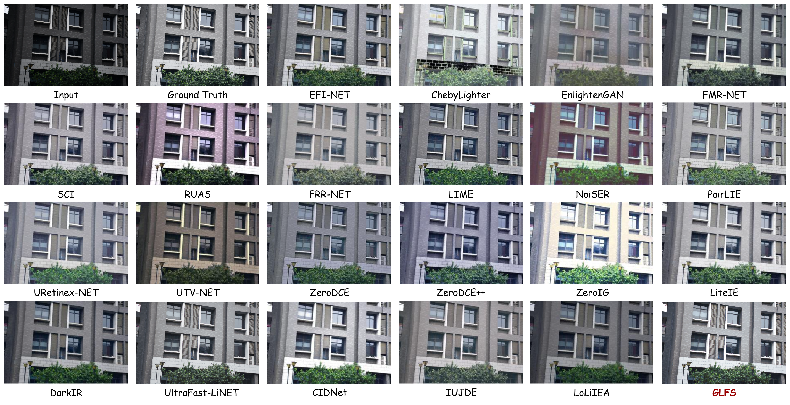</a>

<sub>Paper Fig. 12 · Real scenes captured with a Nikon device.</sub>

### SID — See-in-the-Dark

<a href="Fig/10.png">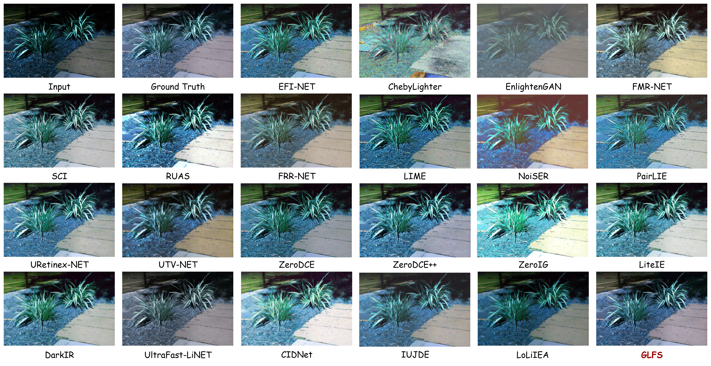</a>

<sub>Paper Fig. 13 · Extreme low-light and challenging noise conditions.</sub>

</div>

## 🧪 Training

### Prepare training images

The released `eval/` directory contains evaluation images. To train from scratch, obtain the original training data from the corresponding dataset providers in accordance with their usage terms.

GLFS uses a two-domain dataset loader. **Domain A is normal-light; domain B is low-light** when `--direction AtoB` is used in training.

```text
datasets/
├── trainA/                # Normal-light RGB training images
│   ├── 0001.png
│   └── 0002.png
├── trainB/                # Low-light RGB training images
│   ├── 0001.png
│   └── 0002.png
├── testA/                 # Optional normal-light domain folder
└── testB/                 # Optional low-light domain folder

my_validation/
├── high/                  # Held-out normal-light reference images
└── low/                   # Corresponding low-light images
```

For paired supervision, corresponding images must have the same filename stem and spatial dimensions. With `--paired_data`, cropping and horizontal flipping are synchronized across each pair.

### Train GLFS with hybrid supervision

The following command explicitly sets the principal architecture and training hyperparameters reported in the paper. Use a new experiment name to avoid overwriting released checkpoints.

```bash
python train.py \
  --dataroot ./datasets \
  --name GLFS_LOLv1_train \
  --checkpoints_dir ./checkpoints \
  --direction AtoB \
  --netG gs_vit \
  --netD multi_scale \
  --ngf 64 \
  --norm instance \
  --n_blocks 4 \
  --num_heads 4 \
  --batch_size 4 \
  --preprocess resize_and_crop \
  --load_size 286 \
  --crop_size 256 \
  --n_epochs 60 \
  --n_epochs_decay 60 \
  --lr 0.0002 \
  --beta1 0.5 \
  --gan_mode lsgan \
  --pool_size 50 \
  --vgg_layers 3 \
  --paired_data \
  --lambda_paired 10 \
  --lambda_paired_ssim 3 \
  --lambda_paired_vgg 1 \
  --use_amp \
  --gpu_ids 0 \
  --eval_dir ./my_validation \
  --best_metric psnr
```

The VGG-based perceptual objective may download pretrained torchvision weights on first use. Adjust batch size if GPU memory is limited; `--use_checkpoint` enables gradient checkpointing for GS-ViT blocks.

By default, training-time validation resizes images to `256 × 256`. To select checkpoints using original-resolution validation, add `--eval_full_res` if memory permits. Use a held-out validation split for checkpoint selection, rather than repeatedly selecting models on the benchmark test set.

The training script supports unpaired data by omitting `--paired_data`; this is a supported alternative, not the paired hybrid-supervision setting used for the reported benchmark results.

Training saves:

```text
checkpoints/GLFS_LOLv1_train/
├── best_net_*.pth          # Best saved model weights
├── latest_net_*.pth        # Latest saved model weights
├── best_info.json         # Best checkpoint information
├── train_config.json      # Configuration for this training run
└── eval_log.csv            # Epoch-wise evaluation and training log
```

## 📂 Repository structure

```text
Gaussian-Light-Field-Splatting/
├── Fig/                   # 11 paper and result figures
├── checkpoints/           # Pretrained model weights
│   ├── LOLv1/
│   ├── LOLv2_Real/
│   ├── LOLv2_Syn/
│   ├── LSRW_Huawei/
│   ├── LSRW_Nikon/
│   └── SID/
├── eval/                  # Paired benchmark evaluation images
│   ├── LOLv1/
│   ├── LOLv2_Real/
│   ├── LOLv2_Syn/
│   ├── LSRW_Huawei/
│   ├── LSRW_Nikon/
│   └── SID/
├── datasets/              # Training-data directory structure
│   ├── trainA/
│   ├── trainB/
│   ├── testA/
│   └── testB/
├── dataset.py             # Dataset loading and paired augmentations
├── networks.py            # MGT, GSA, GS-ViT, GIF and neural networks
├── models.py              # Bidirectional training framework and losses
├── metrics.py             # Image-quality metrics
├── options.py             # Training configuration
├── train.py               # Training entry point
├── evaluate.py            # Inference and evaluation entry point
├── utils.py               # Training utilities
├── LICENSE
└── README.md
```

<details>
<summary><b>Where are the key modules implemented?</b></summary>

| Paper component | Implementation |
| :--- | :--- |
| Multi-Scale Gaussian Tokenizer | [`MultiScaleGaussianTokenizer`](networks.py) |
| Gaussian Splatting Attention | [`GaussianSplattingAttention`](networks.py) |
| GS-ViT block | [`GSViTBlock`](networks.py) |
| Gaussian Illumination Field | [`GaussianIlluminationField`](networks.py) |
| End-to-end generator | [`GSViTGenerator`](networks.py) |
| Hybrid training | [`CycleGANModel`](models.py) |
| Dataset and paired augmentation | [`dataset.py`](dataset.py) |
| Full-resolution inference and tiled fallback | [`evaluate.py`](evaluate.py) |

</details>

## 📚 Citation

If you use GLFS in your research, please cite the published work:

```bibtex
@article{chen2026glfs,
  title   = {Gaussian Light Field Splatting: A Physical Prior-Driven Vision Transformer for Low-Light Image Enhancement},
  author  = {Chen, Yuhan and Yu, Wenxuan and Li, Guofa and Li, Fuchen and Huang, Kunyang and Shi, Yicui and Fang, Ying and Chu, Wenbo and Li, Keqiang},
  journal = {IEEE Transactions on Circuits and Systems for Video Technology},
  year    = {2026},
  note    = {Early Access},
  url     = {https://ieeexplore.ieee.org/document/11797596}
}
```

<details>
<summary>arXiv citation</summary>

```bibtex
@misc{chen2026glfsarxiv,
  title         = {Gaussian Light Field Splatting: A Physical Prior-Driven Vision Transformer for Low-Light Image Enhancement},
  author        = {Chen, Yuhan and Yu, Wenxuan and Li, Guofa and Li, Fuchen and Huang, Kunyang and Shi, Yicui and Fang, Ying and Chu, Wenbo and Li, Keqiang},
  year          = {2026},
  eprint        = {2606.17985},
  archivePrefix = {arXiv},
  primaryClass  = {cs.CV},
  url           = {https://arxiv.org/abs/2606.17985}
}
```

</details>

## 🤝 Acknowledgements

We thank the authors and maintainers of the LOL, LOL-v2, LSRW, and SID datasets, as well as the Gaussian splatting, Transformer, and low-light enhancement research communities.

This work was supported by the National Natural Science Foundation of China (Grants 52672529 and 52372377) and the Young Beijing Scholars Program (Grant 2024-069).

## ⚖️ License

The code is released under the [Apache License 2.0](LICENSE). Third-party datasets and paper figures are subject to their respective licenses, copyright, and usage terms; the code license does not override these rights.

## 💬 Contact & community

Questions, feedback, bug reports, and research discussions are welcome.

- Open an [issue](https://github.com/YuhanChen2024/Gaussian-Light-Field-Splatting/issues) for implementation or reproduction questions. Include your PyTorch/CUDA versions, the dataset or checkpoint, and the command you ran.
- Contributions and fixes are welcome through [pull requests](https://github.com/YuhanChen2024/Gaussian-Light-Field-Splatting/pulls).
- For research inquiries, see the author contact information in the [published paper](https://ieeexplore.ieee.org/document/11797596).

---

<div align="center">

### 🌟 Support GLFS

If you find this work useful, please consider starring the repository, sharing it with the community, and citing our paper.

[](https://github.com/YuhanChen2024/Gaussian-Light-Field-Splatting)

<a href="https://star-history.com/#YuhanChen2024/Gaussian-Light-Field-Splatting&Date">
  <picture>
    <source media="(prefers-color-scheme: dark)" srcset="https://api.star-history.com/svg?repos=YuhanChen2024/Gaussian-Light-Field-Splatting&amp;type=Date&amp;theme=dark">
    <source media="(prefers-color-scheme: light)" srcset="https://api.star-history.com/svg?repos=YuhanChen2024/Gaussian-Light-Field-Splatting&amp;type=Date">
    
  </picture>
</a>

<sub>Gaussian Light Field Splatting · IEEE TCSVT 2026</sub>

</div>
